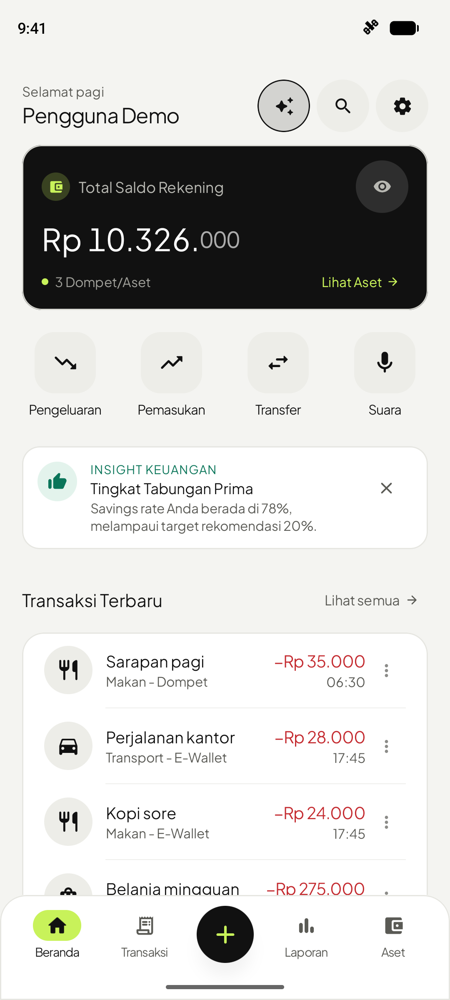
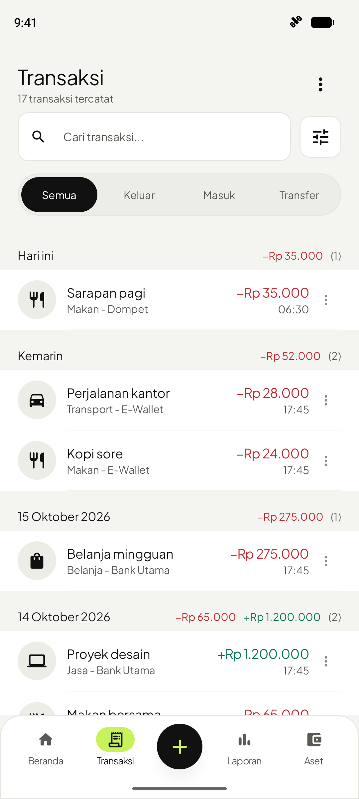
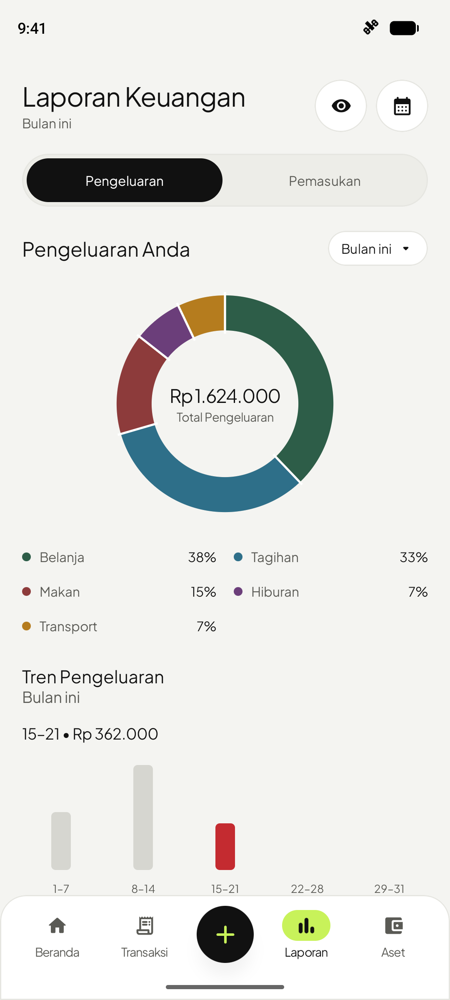
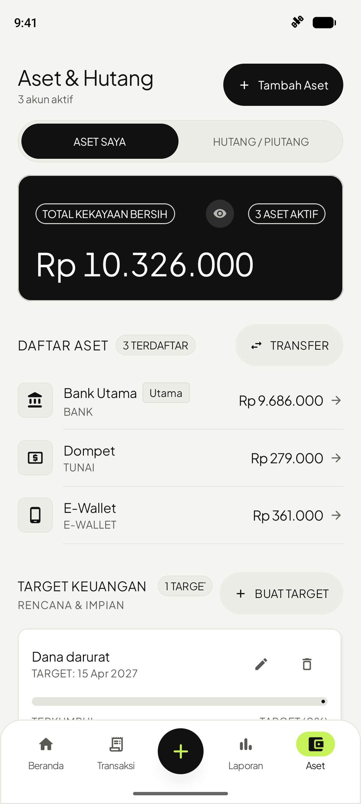
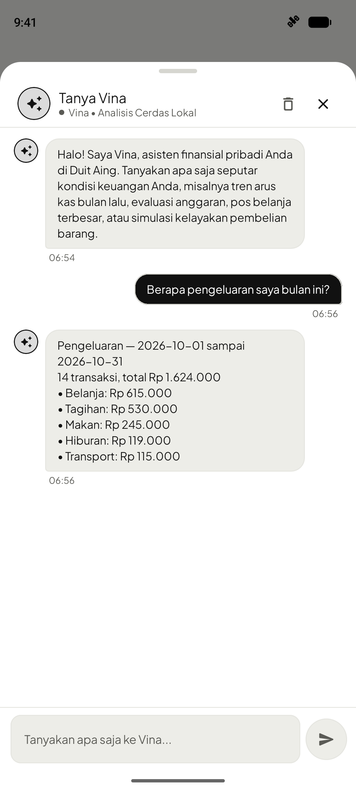
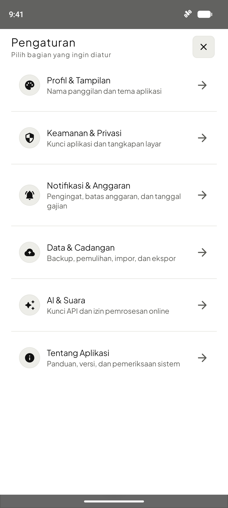

# Duit Aing

**Pencatatan keuangan pribadi untuk Android, dengan data lokal sebagai fondasi.**

Kelola transaksi, rekening, anggaran, hutang, dan target tabungan dalam satu aplikasi. Duit Aing menyediakan pencatatan manual, input suara, pemindaian struk, laporan berdasarkan periode, serta asisten keuangan **Vina**.


[Tampilan](#tampilan-aplikasi) · [Mulai menggunakan](#mulai-menggunakan) · [Fitur](#fitur) · [Vina](#asisten-keuangan-vina) · [Build](#menjalankan-proyek) · [Pengujian](#pengujian) · [Privasi](#data-privasi-dan-koneksi)

## Tampilan aplikasi

Tangkapan layar dari aplikasi yang berjalan di emulator. Seluruh nama, saldo, dan transaksi pada galeri ini menggunakan **data fiktif untuk demonstrasi**. Klik gambar untuk melihat ukuran penuh.

| Beranda | Transaksi | Laporan |
| :---: | :---: | :---: |
| <a href="docs/screenshots/current/home.png"></a> | <a href="docs/screenshots/current/transactions.png"></a> | <a href="docs/screenshots/current/reports.png"></a> |

| Rekening & aset | Asisten Vina | Pengaturan |
| :---: | :---: | :---: |
| <a href="docs/screenshots/current/assets.png"></a> | <a href="docs/screenshots/current/vina.png"></a> | <a href="docs/screenshots/current/settings.png"></a> |

## Sekilas

Duit Aing membantu menjawab tiga pertanyaan sehari-hari: berapa saldo yang dimiliki, ke mana uang dibelanjakan, dan apakah pengeluaran masih sesuai rencana.

Pencatatan utama menggunakan database lokal dan tidak memerlukan pembuatan akun. Fitur online bersifat opsional. Ketersediaan pengenalan suara dan OCR bergantung pada layanan serta kemampuan perangkat.

| Informasi | Nilai |
| --- | --- |
| Versi aplikasi | `1.1.0` — version code `110` |
| Application ID | `com.cashflow.app` |
| Android minimum | Android 8.0 — API 26 |
| Compile / target SDK | API 36 |
| Bahasa antarmuka | Bahasa Indonesia |
| Penyimpanan utama | SQLite di perangkat |

## Fitur

| Area | Kemampuan |
| --- | --- |
| **Transaksi** | Pemasukan, pengeluaran, transfer antar rekening, kategori, tanggal, catatan, tag, dan lampiran struk. |
| **Rekening & aset** | Pisahkan uang tunai, rekening bank, e-wallet, serta aset lainnya; pantau saldo masing-masing. |
| **Pencatatan cepat** | Input nominal Rupiah, tombol penambah nominal, pengenalan suara, OCR struk, pintasan, dan jadwal transaksi berulang. |
| **Riwayat** | Pencarian, filter jenis/periode/kategori/rekening, detail transaksi, serta penyuntingan catatan. |
| **Laporan** | Ringkasan pemasukan dan pengeluaran, komposisi kategori, tren, periode cepat, serta rentang tanggal melalui kalender. |
| **Anggaran** | Batas belanja per kategori dengan periode mingguan atau bulanan dan pemantauan pemakaian. |
| **Hutang & piutang** | Catatan pihak terkait, jatuh tempo, sisa pinjaman, dan pembayaran bertahap. |
| **Target keuangan** | Tujuan tabungan, progres, setoran, dan pencairan dana target. |
| **Vina** | Tanya jawab keuangan dari catatan lokal; integrasi Gemini tersedia sebagai pilihan online. |
| **Backup & ekspor** | Cadangan JSON, opsi cadangan terenkripsi, ZIP dengan struk, pemulihan data, impor CSV, serta ekspor PDF/CSV. |
| **Kenyamanan** | Tema terang/gelap, penyembunyian nominal, kunci biometrik, pengaturan privasi, dan pengingat. |
| **Panduan pengguna** | Tur 14 langkah pada layar aplikasi serta panduan tambahan yang bisa dibaca per fitur. |

## Mulai menggunakan

1. **Buat rekening pertama.** Isi nama, jenis, dan saldo awal sesuai uang yang sudah dimiliki. Saldo awal tidak perlu dicatat ulang sebagai pemasukan.
2. **Ikuti tur aplikasi.** Tur mengenalkan saldo, rekening, setiap bagian formulir transaksi, pencarian, Vina, dan laporan. Contoh tur tidak disimpan sebagai transaksi.
3. **Catat transaksi melalui tombol `+`.** Pilih jenis, nominal, kategori, rekening, dan tanggal; periksa sebelum menyimpan.
4. **Periksa hasilnya.** Riwayat tersedia di **Transaksi** dan ringkasannya di **Laporan**. Sesuaikan periode dengan tanggal transaksi.
5. **Buat cadangan berkala.** Buka **Pengaturan → Data & Cadangan** dan simpan file di lokasi yang dapat diakses kembali.

Tur dapat dilewati dan diulang melalui **Pengaturan → Tentang Aplikasi → Panduan Aplikasi**. Panduan tambahan membahas anggaran, target keuangan, hutang/piutang, Vina, backup, dan pencatatan cepat.

> **Pilih jenis transaksi dengan tepat:** gaji adalah pemasukan, membeli makan adalah pengeluaran, sedangkan memindahkan saldo BCA ke GoPay adalah transfer antar rekening sendiri.

## Asisten keuangan Vina

### Mode lokal

Vina lokal menggunakan aturan bahasa dan perhitungan atas data aplikasi. Mode ini tidak membutuhkan API key dan bukan model bahasa besar yang dilatih di perangkat.

Contoh pertanyaan:

- `Berapa pengeluaran saya bulan lalu?`
- `Berapa pemasukan saya minggu ini?`
- `Kategori apa yang paling banyak saya belanjakan bulan ini?`
- `Tampilkan 5 pengeluaran terbesar bulan ini.`

Sebutkan periode, kategori, atau rekening bila diperlukan. Dukungan pertanyaan mengikuti kemampuan parser lokal; pertanyaan di luar cakupannya dapat memerlukan penjelasan ulang. Jika hasil kosong, periksa data dan tanggal transaksi terlebih dahulu.

### Mode online

Integrasi online yang tersedia pada kode saat ini adalah **Google Gemini**. Pengguna mengatur API key dan izin melalui **Pengaturan → AI & Suara**. API dari provider lain belum dapat dipasang sebagai pengganti langsung melalui antarmuka aplikasi.

Mode online bergantung pada internet, ketersediaan model, kuota, dan layanan provider. Saat layanan gagal, jalur bantuan lokal tetap tersedia. Mengaktifkan AI online memungkinkan pertanyaan, riwayat percakapan, dan konteks keuangan yang disusun aplikasi diproses oleh provider; periksa pengaturannya sebelum menggunakan fitur ini.

## Data, privasi, dan koneksi

| Komponen | Perilaku |
| --- | --- |
| Pencatatan & laporan | Data utama disimpan dan dihitung menggunakan SQLite lokal. |
| Vina lokal | Analisis berbasis catatan aplikasi tanpa panggilan API AI. |
| Vina online | Memanggil layanan Gemini bila dikonfigurasi dan diizinkan. |
| Input suara | Parsing transaksi berjalan lokal. Pengenalan audio memakai layanan Android; mode lokal memerlukan dukungan on-device, sedangkan layanan online memerlukan izin pengguna. |
| OCR struk | Menggunakan ML Kit di perangkat; ketersediaannya mengikuti komponen pengenalan teks perangkat. |
| API key | Disimpan terenkripsi dengan kunci yang dikelola Android Keystore. |
| Backup | Cadangan manual dibuat atau dipulihkan oleh pengguna. Enkripsi memerlukan kata sandi. Android Auto Backup juga diizinkan oleh manifest, mengikuti pengaturan sistem; berkas kredensial dikecualikan melalui aturan backup. |
| Biometrik & tangkapan layar | Perlindungan mengikuti konfigurasi aplikasi dan kemampuan perangkat. |

File backup, struk, dan ekspor dapat berisi informasi pribadi. Simpan di lokasi yang sesuai dan buat cadangan sebelum pemulihan atau penghapusan data. Jangan memasukkan database, API key, kata sandi, atau backup pribadi ke repositori.

## Menjalankan proyek

### Prasyarat

- Android Studio dengan dukungan versi Android Gradle Plugin yang digunakan proyek.
- Android SDK Platform 36 dan Android SDK Platform-Tools.
- JDK **25** untuk daemon Gradle, sesuai `gradle/gradle-daemon-jvm.properties`. Target kompatibilitas sumber Java pada modul aplikasi adalah Java 17.
- Perangkat atau emulator Android API 26 atau lebih baru.

Versi build dikunci melalui Gradle Wrapper dan version catalog: **Gradle 9.5.0**, **Android Gradle Plugin 9.3.1**, serta **Kotlin 2.2.10**. Gunakan konfigurasi proyek sebagai acuan saat menyiapkan lingkungan.

### Build debug

```bash
git clone https://github.com/agungrmdniiii/cashflow-android.git
cd cashflow-android
```

Buka direktori tersebut di Android Studio dan tunggu sinkronisasi Gradle. Pastikan lokasi SDK tersedia melalui konfigurasi lokal Android Studio atau `local.properties` milik mesin Anda.

**Windows / PowerShell**

```powershell
.\gradlew.bat :app:assembleDebug
```

**macOS / Linux**

```bash
./gradlew :app:assembleDebug
```

APK hasil build tersedia di:

```text
app/build/outputs/apk/debug/app-debug.apk
```

Pasang ke satu perangkat/emulator yang terhubung:

```bash
adb install -r app/build/outputs/apk/debug/app-debug.apk
```

Jika ada beberapa perangkat, tambahkan `-s SERIAL` pada perintah `adb`. Opsi `-r` mempertahankan data untuk pembaruan yang kompatibel dengan package dan tanda tangan yang sama. APK debug ditujukan untuk pengujian; distribusi produksi memerlukan konfigurasi penandatanganan release.

## Pengujian

```powershell
.\gradlew.bat :app:testDebugUnitTest :app:lintDebug :app:assembleDebug
```

Tes instrumentasi memerlukan perangkat atau emulator. Untuk menjalankan tes tur secara terpisah:

```powershell
.\gradlew.bat :app:connectedDebugAndroidTest "-Pandroid.testInstrumentationRunnerArguments.class=com.cashflow.app.AppTourTest"
```

Cakupan pengujian meliputi integritas saldo, operasi ledger, periode anggaran, grafik, rentang laporan, impor CSV, parser suara, Vina lokal, penanganan jaringan, dan tur aplikasi.

Pada verifikasi **17 Oktober 2026**, **194 tes unit** dan **6 tes tur** lulus; build debug dan lint selesai tanpa error. Masih ada peringatan lint. Pengujian UI tur dilakukan pada emulator, termasuk lebar 360 dp; hasil tersebut tidak mewakili pengujian seluruh perangkat fisik.

> Tes database audit tertentu mengubah data pengujian. Gunakan emulator khusus pengujian, bukan instalasi yang berisi catatan keuangan pribadi. Tes tur memakai berkas preferences terisolasi dan tidak menyimpan transaksi contoh. Sebagian tes UI berbasis Espresso dibatasi hingga API 36 karena kompatibilitas injector versi yang digunakan proyek.

Laporan lokal dihasilkan di `app/build/reports/`. Folder build, bukti audit lokal, dan konfigurasi mesin tidak termasuk sumber yang dipublikasikan.

## Struktur proyek

```text
app/src/main/java/com/cashflow/app/
├── data/
│   ├── backup/       # Pembuatan dan pemulihan cadangan
│   ├── db/           # Skema SQLite dan migrasi
│   ├── export/       # Pembuatan laporan PDF
│   ├── importer/     # Impor data
│   ├── model/        # Model transaksi, rekening, anggaran, dan laporan
│   ├── network/      # Penanganan permintaan dan kegagalan jaringan
│   ├── preferences/  # Preferensi dan penyimpanan kredensial
│   ├── repository/   # Akses data dan operasi ledger
│   └── service/      # Analisis, Vina, OCR, dan pengingat
├── security/         # Dukungan biometrik
├── ui/               # StateFlow/ViewModel, layar Compose, komponen, dan tema
├── voice/            # Pengenalan suara dan parser transaksi
└── widget/           # Akses cepat dari layar utama Android
```

Tes unit berada di `app/src/test/`, sedangkan tes yang memerlukan Android berada di `app/src/androidTest/`.

## Kontribusi dan laporan masalah

Laporkan masalah melalui [GitHub Issues](https://github.com/agungrmdniiii/cashflow-android/issues). Sertakan versi aplikasi, versi Android, langkah reproduksi, serta hasil yang diharapkan dan yang terjadi. Hapus informasi pribadi dari screenshot atau contoh data.

Untuk kontribusi kode, buat branch terpisah, pertahankan pola proyek yang ada, jalankan pemeriksaan yang relevan, dan jelaskan perubahan beserta hasil validasinya dalam pull request. Panduan perubahan versi tersedia di [CHANGELOG.md](CHANGELOG.md).
